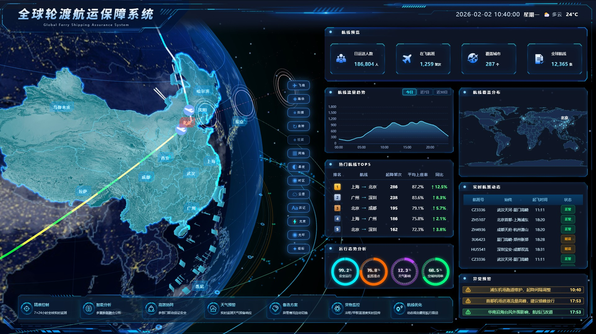
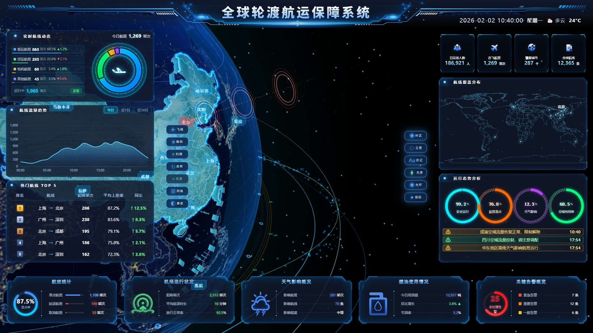

# 👋 你好，我是 齐佩哲

个人优势：

•　技术与产品复合能力：计算机科学与技术专业背景，具备一定的技术理解与产品设计能力，能够结合业务场景分析需求、梳理功能逻辑，并与技术实现相结合。

•　需求分析与方案设计：具备从业务问题出发进行需求拆解、功能规划、流程设计和 PRD 撰写的实践经验，能够通过 Axure、Figma 等工具输出高保真原型与产品方案

•　AI 应用落地能力：围绕企业风险监测、智能客服等场景开展 AI 产品设计实践，了解 LLM、RAG、Prompt 设计与效果评测，能够结合业务需求设计 AI 工作流、知识检索及异常场景处理机制。

•　原型验证与持续迭代：能够借助 AI 编程工具将产品方案转化为可运行 Demo，并通过测试、问题分析与方案调整持续迭代，具备从需求分析到原型验证的实践能力。

> 全栈开发 / AI 应用开发者 · 专注用大模型构建能落地的业务系统：客服自动化、知识库问答、运营数据分析、企业风险监测
> （把“业务痛点 → 系统 + AI 需求”做成真能跑、能演示、有评测数字的产品）

---

## 🚀 精选项目

### 🚢 跨境物流智能客服工作台（Logistics Copilot）

把客服收到的非结构化求助消息（邮件 / 微信 / 电话记录）**自动变成结构化工单 + 智能分类 + 建议回复**，配套 **RAG 知识库问答** 和 **运营看板**。

| | |
|---|---|
| ⚙️ 技术栈 | FastAPI · SQLAlchemy · OpenAI 兼容 LLM（GLM-4-Flash）· BM25 RAG · ECharts · SQLite/PostgreSQL |
| ✨ 工单结构化 | 一次 LLM 调用提取 8 字段（分类/紧急度/意图/提单号/柜号/起运港/目的港）+ 建议回复；无 API Key / 断网自动降级规则模式，全流程不中断 |
| 📚 知识库问答 | Obsidian Markdown 幂等同步 → 切块 → BM25 检索 → 回答带【来源】标注；答不上自动建议转人工 |
| 📊 运营看板 | 4 KPI + 近 7 日趋势 / 分类分布 / Top 意图 / 超时工单，指标全部 SQL 聚合，前端零写死数字 |
| 🧪 评测背书 | 20 条人工标注集：分类准确率规则 100% / LLM 经两轮 Prompt 调优 40% → 95%+，字段提取幻觉 3 处 → 0 |

👉 **[查看项目仓库](https://github.com/jumao-78/logistics-copilot-workbench)** · 全部代码 / 评测报告 / 数据库切换指南 / 知识库管理指南

**工作台总览**

| 工单收件箱 | 知识库管理 |
|---|---|
|  |  |

| 知识库问答 · 回答带【来源】标注 | Agent 流程 |
|---|---|
|  |  |

| 运营看板 · 4 KPI + 近 7 日趋势 | 系统设置 |
|---|---|
|  |  |

> ⚠️ 本项目为演示项目，所有数据均为模拟数据（管道真实、数据为造），可在本地完全离线运行。

---

### 🌐 全球轮渡航运保障系统 · 数据大屏

Vue 3 + TypeScript + Three.js + ECharts 构建的航运态势可视化大屏。1920×1080 设计稿等比适配，屏 A（全球）/ 屏 B（中国区）双视图切换。

🔗 **[在线演示](https://jumao-78.github.io/)** · 打开即是完整大屏，无需安装

| 屏 A · 全球态势 | 屏 B · 中国区 |
|---|---|
|  |  |

| | |
|---|---|
| 🧊 三维主场景 | Three.js 自定义 GLSL 着色器：地球纹理、昼夜切换、云层、城市标签、时区分区、自动旋转 |
| ✨ 航运动效 | 城市贴地能量环、数据环、飞线路径与流动轨迹 |
| 🖥 双视图 | 屏 A（全球）/ 屏 B（中国区），相机与地球位姿 1200ms 补间过渡 |
| 📊 面板系统 | 航班统计、机场运行状况、天气影响概况、燃油使用情况、关键告警概览、航线流量趋势、航线覆盖分布、运行态势分析 |
| 🎛 场景控制 | 13 项图层与效果开关，状态与三维场景双向同步 |
| 📐 自适应 | 1920×1080 基准，`transform: scale()` 按视口等比缩放 |

> ⚠️ 演示数据为模拟数据，用于展示可视化与交互能力。

---

### 🏢 企业风险监测系统（Enterprise Risk Monitor）

把分散在信用中国、企查查、地方黑名单里的企业风险，汇总成 **「一屏能看出问题」的结论**并留痕可追溯。原系统只有 9 页 PPT、无代码无手册，本项目在其基础上做 **增强重设计（非复刻）**：信息一项不少、版式重做，交付 6 页签高保真原型 + 四套工程文档 + 可复现取数管道。

| | |
|---|---|
| ⚙️ 技术栈 | Python 3.12 · MySQL 8（独立实例 / 7 表）· pymysql · deepseek-flash · Playwright · ddddocr · APScheduler · smtplib(QQ SSL) |
| 🖥 6 页签原型 | 总览 / 风险明细 / 取数任务 / AI 与邮件 / 配置 / 系统设置，桌面 + 移动双端；单文件原型零依赖，双击即开 |
| 🧭 工程约束 | 取数**四态**而非布尔（`NO_RECORD` ≠ 无风险）· AI 只解读**不定级**（等级由 11 类规则映射，出参禁 `level`）· 徽章后端算、前端只渲染 · 状态单一来源 `task_record` · 演示标识强制常驻 |
| 📄 文档体系 | 需求分析 / 技术选型 / 开发实施 / UI 设计说明书 v3.0 / 决策台账 / PRD，约 3 万字，每条结论可追溯到决策来源 |
| 🔌 数据管道 | 信用中国批量查询 → 密云黑名单解析 → 快照归一化 → MySQL 入库；25 家真实名单 + 20 家脱敏演示名单 |
| 🎯 设计取向 | 受众是「看结论的领导」与「排障的操作者」——取数链路、异常状态、数据来源全部显性化，不让空白格看起来像"没问题" |

👉 **[查看项目仓库](https://github.com/jumao-78/enterprise-risk-monitor)** · [单文件原型](https://github.com/jumao-78/enterprise-risk-monitor/blob/main/%E4%BC%81%E4%B8%9A%E9%A3%8E%E9%99%A9%E7%9B%91%E6%B5%8B_%E5%8E%9F%E5%9E%8B%E6%B1%87%E6%80%BB.html) · [UI 设计说明书 v3.0](https://github.com/jumao-78/enterprise-risk-monitor/blob/main/%E4%BC%81%E4%B8%9A%E9%A3%8E%E9%99%A9%E7%9B%91%E6%B5%8B%E7%B3%BB%E7%BB%9F_UI%E8%AE%BE%E8%AE%A1%E8%AF%B4%E6%98%8E%E4%B9%A6_v3.0.md)

**总览** —— 4 张 KPI + 今日取数四段流水线 + 近七日趋势

| 风险明细 · 取数四态（`NO_RECORD` 单独成列） | 取数任务 · 双源并行 + 任务历史 |
|---|---|
|  |  |

| AI 与邮件 · 归档可追溯 + 主题带 `[演示]` | 配置 · 来源只读 + 密钥默认掩码 |
|---|---|
|  |  |

**系统设置** —— 6 项自检，把"企查查登录态失效"这类真实异常原样暴露，不粉饰

| 移动端 · 总览 | 移动端 · 风险明细 |
|---|---|
|  |  |

> ⚠️ 本项目为**设计交付 + 可交互原型**，未上线；数据为 2026-10-21 快照而非实时抓取，页面常驻「演示模式」标识。企查查账号无查询权限，取数以 `no_permission` 显式暴露，不静默降级为"无风险"。

---

### 🎨 UI 设计作品集

15 页 UI 设计作品展示（界面设计 / 视觉稿 / 方案展示），由演示文稿逐页导出为高清图，另含 **UI 交互录屏演示**。

👉 **[查看 UI 设计作品集](https://github.com/jumao-78/ui-design-portfolio)** · 🎬 [交互演示视频](https://github.com/jumao-78/ui-design-portfolio/blob/main/videos/ui_demo.mp4) · [第 1 页](https://github.com/jumao-78/ui-design-portfolio/raw/main/pages/01.png) · [第 8 页](https://github.com/jumao-78/ui-design-portfolio/raw/main/pages/08.png)

---

### 🧰 更多项目

- [📋 全部仓库](https://github.com/jumao-78?tab=repositories)

---

## 🛠 技术栈

Python · FastAPI · SQLAlchemy · SQLite / PostgreSQL · OpenAI 兼容 LLM · Prompt 工程 · RAG（BM25 → 向量检索升级路径）· ECharts · MySQL · Playwright · Git / GitHub

## 📬 联系我

- 📧 邮箱：[3300486842@qq.com](mailto:3300486842@qq.com)
- 📱 电话：13937217130
